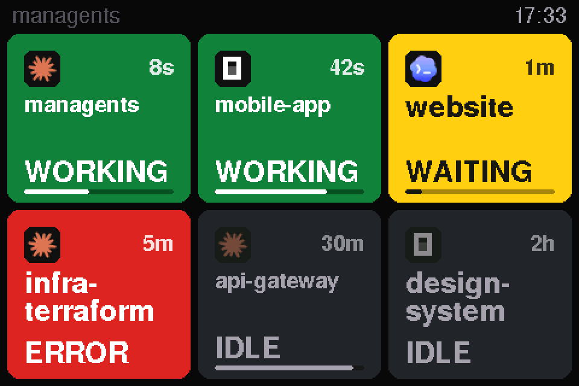

<h1 align="center">managents</h1>

<p align="center">
  
</p>

<p align="center">
  <b>A USB desk display that shows, at a glance, what your AI coding agents are doing.</b>
</p>

<p align="center">
  <a href="https://github.com/tonylook/managents/actions/workflows/ci.yml"></a>
  <a href="https://github.com/tonylook/managents/releases/latest"></a>
  <a href="LICENSE"></a>
</p>

One card per open [Claude Code](https://claude.com/claude-code) or [OpenCode](https://opencode.ai) session: green while
it works, yellow when it waits for you, red when it failed, dark when it has been idle for hours. Plug it in and stop
alt-tabbing to check whether an agent needs you.

managents is a small 4-inch screen, a helper program on your computer and a 3D-printed stand. This repository has
everything you need to build one yourself.

## What you need

- **The display:** an LCDWiki 4.0" ESP32-32E, model **E32R40T**. The firmware and the stand are made for this exact
  board.
- **A USB-C data cable.**
- **The stand:** two 3D-printed parts (the files are in this repository), 4 self-tapping screws ST2.9 x 9.5 and 4
  self-adhesive rubber feet.
- **A Mac or Linux computer** that runs Claude Code or OpenCode.

Where to buy each part and what to type in the search box: [Build guide](docs/build.md).

## Get started

1. **Get the parts and print the stand.** Follow the [build guide](docs/build.md).
2. **Install the helper on your computer** (once):

   ```sh
   curl -fsSL https://github.com/tonylook/managents/releases/latest/download/install.sh | sh
   ```

3. **Plug in the display and flash it** (once per board, about 13 seconds):

   ```sh
   managents flash
   ```

Within a couple of seconds every open Claude Code and OpenCode session is a card on the display. The helper starts
at login, so from now on you only plug the display in. The details, Windows and the uninstall are in
[Install and flash](docs/install.md).

### Or let your AI do it

Open your AI coding agent and tell it:

> Go to https://github.com/tonylook/managents and install managents on my computer, then flash my display.

[AGENTS.md](AGENTS.md) explains every step to the agent: how to install the helper, how to flash a new board, and how
to check that it works. It shows you each command before it runs it.

## More

| | |
|---|---|
| [Build guide](docs/build.md) | What to buy, how to search for it, how to print and assemble the stand |
| [Install and flash](docs/install.md) | The helper, the firmware, upgrade, uninstall, supported computers |
| [Using the display](docs/using.md) | What every card, colour and screen means |
| [Troubleshooting](docs/troubleshooting.md) | Symptom, check, fix |
| [Privacy](docs/privacy.md) | What the helper reads and what leaves your computer: only status, over USB |
| [How it works](docs/architecture.md) | Architecture, the [serial protocol](docs/protocol.md), the [hardware](docs/hardware.md) |
| [Enclosure](enclosure/README.md) | The OpenSCAD model, print settings, assembly |
| [Contributing](CONTRIBUTING.md) | Tests, lint, adding an agent; the [roadmap](docs/roadmap.md) and the [changelog](CHANGELOG.md) |

## Credits and license

managents grew out of *agent-lights*, a phone-based proof of concept. Built with
[LovyanGFX](https://github.com/lovyan03/LovyanGFX), [ArduinoJson](https://arduinojson.org),
[go.bug.st/serial](https://github.com/bugst/go-serial), [gopsutil](https://github.com/shirou/gopsutil) and
[modernc.org/sqlite](https://gitlab.com/cznic/sqlite); see [THIRD_PARTY_NOTICES.md](THIRD_PARTY_NOTICES.md). Released
under the [MIT license](LICENSE).

Claude and Claude Code are trademarks of Anthropic; OpenCode belongs to its authors. This project is not affiliated
with either.
