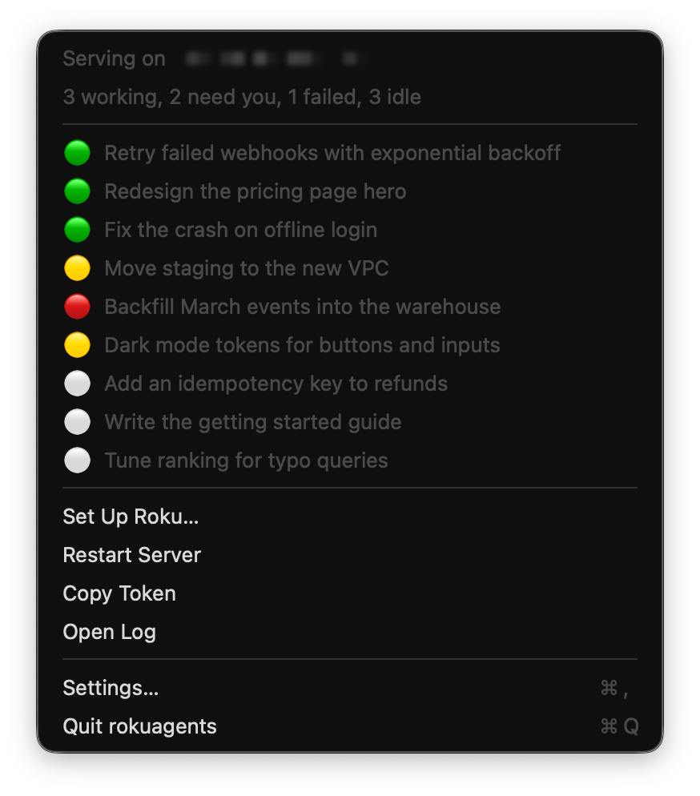
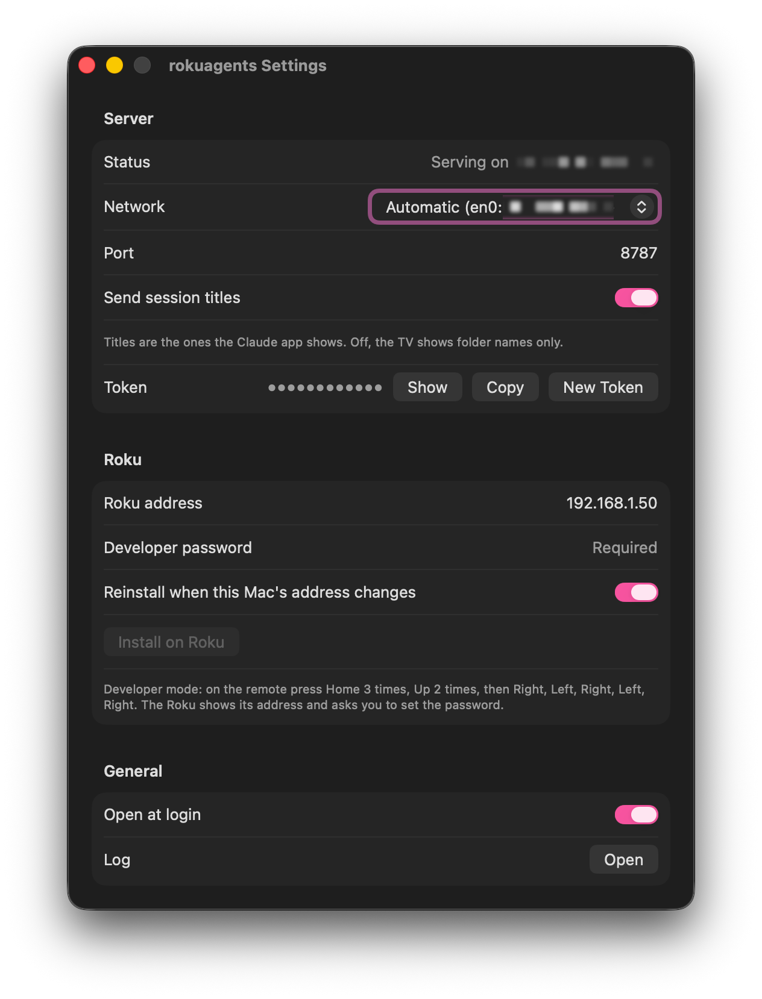

# rokuagents menu bar app

A Mac menu bar app that runs the session server and keeps the Roku channel pointed at it. It replaces steps 2 to 5
of the command-line setup in the [main README](../README.md#get-started).

<p align="center">
  
  
</p>

- **Runs the server.** The app starts its own copy of `managents serve` and restarts it if it stops. Quit the app and
  the server stops.
- **Follows your network.** When your Mac's address changes (another Wi-Fi network, Ethernet, a new DHCP lease), it
  restarts the server on the new address. The channel finds the server there by itself, through
  [discovery](../docs/http-api.md#discovery), within a few seconds. As a fallback, for a channel installed before
  discovery existed, the app also reinstalls the channel with the new address.
- **Shows status in the menu bar.** The TV icon is crossed out while the server is down, and shows how many sessions
  need you. The menu lists the open sessions with their titles.
- **Installs the channel.** "Install on Roku" builds the channel with the current address and token and sideloads
  it, which is what `roku/build.sh` does.

## Build and install

Needs macOS 15 or later, Go 1.26+ (`brew install go`) and Xcode or its command-line tools.

```sh
cd macos
./build.sh --install
```

This builds `dist/rokuagents.app`, copies it to `~/Applications` and opens it. Without `--install` it only builds.
Rerun it to update the app after pulling changes.

## First run

1. **If you used the command-line setup**, the app finds its LaunchAgent (`com.managents.serve`) and waits, since
   both would use the same port. Open Settings and click **Disable the LaunchAgent**. It is unloaded and its plist is
   renamed to `com.managents.serve.plist.disabled`, so you can bring it back by renaming it.
2. **Allow incoming connections.** macOS asks whether `managents` may accept incoming network connections. Click
   Allow, or the Roku cannot reach the server. If you missed it: System Settings > Network > Firewall > Options.
3. **Allow local network access** if macOS asks. The app uses it to read the server and to install on the Roku.
4. **Set up the Roku.** In Settings, enter the Roku's address and its developer password, then click **Install on
   Roku**. The password is kept in your login keychain.
5. **Turn on Open at login** in Settings.

The app uses the same token file as the command-line setup, `~/.config/managents/token`, and creates it if it is
missing. **New Token** in Settings replaces it and reinstalls the channel.

## Settings

| Setting | What it does |
|---|---|
| Network | Automatic uses the lowest-numbered Wi-Fi or Ethernet interface with a home network address (en0 before en1), never a VPN or virtual machine bridge. Pick an interface to stay on it. |
| Port | 8787 by default. Press Return to apply. |
| Send session titles | Off, the TV shows folder names only (`--titles=false`). |
| Reinstall when this Mac's address changes | On by default. A fallback: a channel installed by this version finds the new address by itself, so it can be off. Off, a channel from before discovery shows "Reconnecting..." until you install again. The app only reinstalls by itself on the Roku you last installed on: it checks the device's serial number first, so on another network a different device at the same address never gets the channel or the token. |

The server's log is `~/Library/Logs/rokuagents-serve.log` (menu: **Open Log**).

## Uninstall

Quit the app from its menu, delete `~/Applications/rokuagents.app`, and optionally
`~/Library/Logs/rokuagents-serve.log`. The Roku developer password is in Keychain Access under
"rokuagents Roku developer password".

## How it is built

| Path | What it does |
|---|---|
| `Sources/RokuAgentsCore` | Logic with no UI: choosing the address (`LAN`), reading `/state` (`StateFrame`), the token file (`TokenStore`), packaging and installing the channel (`ChannelPackage`, `RokuInstaller`) |
| `Sources/RokuAgents` | The app: `AppModel` (network watching, server, polling, Roku), `ServerProcess`, the menu and the settings window |
| `Tests/RokuAgentsCoreTests` | Unit tests for the core |
| `build.sh`, `Info.plist` | Builds the helper and the app, puts the channel files in the bundle, signs it ad hoc |

The bundle holds `Contents/MacOS/managents` (built from `../helper`) and the channel in `Contents/Resources/roku`.
It is signed ad hoc, which is enough to run on the Mac that built it. Running it on another Mac would need a
Developer ID signature and notarization.

Run the tests with `swift test`. One test installs the channel on a real Roku and runs only when you give it one:

```sh
ROKU_IT_HOST=192.168.1.50 ROKU_IT_PASSWORD=your-dev-password ROKU_IT_SERVER=http://192.168.1.20:8787 \
  ROKU_IT_TOKEN="$(cat ~/.config/managents/token)" swift test --filter RokuIntegrationTests
```
